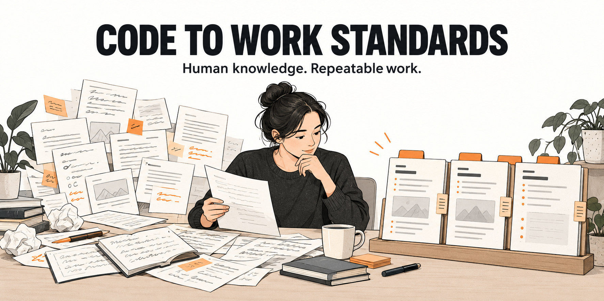
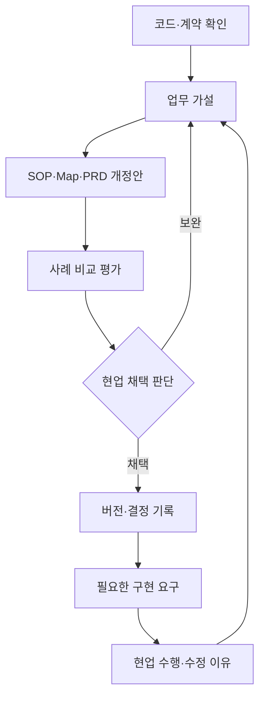

# 왜 AI 에이전트에게 맡겨도 사람이 다시 봐야 할까요?

**Code to Work Standards — Code → SOP & Map of Work → Practitioner Validation → Iterative Improvement**

사람이 고친 이유를, 다음 에이전트가 따를 기준으로 만듭니다.



[PDF 27쪽 읽기](reports/workflow-standards-v0.1.pdf) · [PDF 해설](docs/pdf-reading-guide.md) · [English](README.en.md) · [기여 시작하기](CONTRIBUTING.md) · [이슈 제안](https://github.com/thuygom/code-to-work-standards/issues/new/choose)

**[기여 웹사이트 열기 ↗](https://standard.linh.day/)** — MoW·PRD·SOP와 경험·인사이트를 찾아 가져가고, 웹에서 본문·첨부를 접수하거나 GitHub 이슈로 제안할 수 있습니다. 웹사이트와 앱의 소스 코드는 별도로 관리합니다.

## 에이전트는 일을 끝냈는데, 우리의 일은 왜 남아 있을까요?

회의록은 매끄럽지만 제안을 확정된 결정으로 바꿉니다. 기업 분석에는 링크가 많지만 고객의 문제와 우리 제품이 왜 연결되는지 설명하지 못합니다. API는 성공했지만 검토·저장·인계는 남아 있습니다.

이럴 때 필요한 것은 **현업이 결과를 판단하는 기준을 관찰하고, 다시 수행할 수 있는 절차로 남기는 작업**입니다. 무엇을 먼저 확인하는지, 어떤 근거를 믿는지, 언제 보류하는지, 누가 무엇을 확인해야 완료인지가 있어야 합니다.

이 저장소는 여러 분야의 현업이 함께 업무 기준을 만드는 독립적인 공개 프로젝트입니다. 기여자가 공유한 사례·관찰·공개 가능한 코드에서 업무 가설을 세우고, SOP·PRD·Map of Work 초안을 작성한 뒤 실제 사례로 검증합니다. 사람의 수정 이유를 다음 버전의 업무 규칙과 평가 사례로 연결합니다.

**현재 상태: v0.1, 현업 검증 전.** 업무 가설과 합성 예시를 제공합니다. 실제 품질 개선율·시간 절감·배포 성과는 아직 측정하지 않았습니다.

## 이 프로젝트가 만드는 것

| 산출물 | 답하는 질문 | 바로 보기 |
|---|---|---|
| Map of Work | 누가 무엇을 넘기고, 어디서 기다리거나 되돌아갑니까? | [노트·회의록](workflows/notes/map-of-work.md), [기업·영업 분석](workflows/company-analysis/map-of-work.md) |
| SOP | 어떤 순서와 판단 기준으로 일을 수행합니까? | [N01–N12](workflows/notes/sop.md), [B01–B14](workflows/company-analysis/sop.md) |
| PRD | 도구가 어떤 동작을 해야 업무가 완료됩니까? | [노트 요구사항](workflows/notes/prd.md), [분석 요구사항](workflows/company-analysis/prd.md) |
| 현업 관찰·평가 | 어디를 왜 고쳤고, 변경이 다른 사례에도 유효합니까? | [관찰 양식](templates/observation.md), [평가 운영](evaluation/README.md) |
| 변경 결정 | 무엇을 채택하고 보류했으며, 어떤 근거로 바꿨습니까? | [변경안](templates/change-proposal.md), [결정 기록](templates/decision.md) |

SOP는 **Standard Operating Procedure**, PRD는 **Product Requirements Document**입니다. 코드의 호출 흐름은 현재 구현의 근거입니다. 실제 현업의 수행 방식과 좋은 결과의 기준은 관찰과 사례 검증으로 확인합니다.

## 처음 다루는 두 업무

| 업무군 | 결과물 | 중요하게 보는 것 |
|---|---|---|
| **N: 노트·회의록** | N1 개인·모바일 노트 / N2 팀 공유 회의록 | 결정·요청·미결, 담당자·기한, 원문 근거, 실제 후속 처리 |
| **B: 기업·영업 분석** | B1 기업·제품 사실 리포트 / B2 자사제품 연결 검토 | 기업 동일성, 출처의 주장 범위, 니즈 가설, 제품 기능·제약, 다음 영업 행동 |

두 업무는 작성 방식과 판단 기준을 설명하기 위한 초기 초안입니다. 특정 제품의 사양이나 공식 연동 목록을 뜻하지 않습니다. 누구나 자신의 분야·프로젝트에서 사례를 기여할 수 있으며, 프로젝트명과 코드 출처는 공개 범위를 확인한 개별 기여에 기록합니다. [기여별 근거 기록](docs/code-evidence.md)

### 회의록: 요청의 존재와 수락 여부를 구분합니다

가상의 발언이 “김 대리님, 금요일까지 초안을 보내 주세요”라면 요청 대상과 기한을 남겨야 합니다. 수락 발화가 없다는 이유로 이를 삭제하면 원문 정보가 사라집니다. 수락·합의 여부는 별도 상태입니다. “금요일까지 검토해 보면 어떨까요?”라는 제안은 확정 업무와 다르게 처리합니다.

이 차이를 **SOP의 판단 규칙 → PRD의 수용 조건 → 평가 사례**에 연결합니다. [합성 사례 따라가기](examples/SYN-N-001.md)

### 기업 분석: 근거에서 다음 영업 행동까지 연결합니다

자사제품 연결의 최소 단위는 다음과 같습니다.

1. 확인한 고객 사실
2. 그 사실에서 도출한 업무 문제 가설
3. 자사제품의 현재 제공 기능과 근거
4. 성립 조건·제약·부적합 조건
5. 반대 근거를 점검한 결과와 아직 모르는 내용
6. 고객에게 확인할 질문과 다음 영업 행동

“증설 계획 발표”와 실제 착공·완료, 고객의 구매 의사는 다른 사실입니다. 공식 자료도 뒷받침할 수 있는 주장 범위가 있습니다. 제품 로드맵은 현재 제공 기능으로 표시하지 않습니다. [합성 사례 따라가기](examples/SYN-B-001.md)

## 반복 개선은 이렇게 진행합니다



**CODE → OBS → SOP/PRD → CASE → RUN → DEC**를 연결합니다. 모든 단계가 언제나 일렬로 진행되는 것은 아니며, 실제 관찰이 코드 분석의 가정을 뒤집을 수도 있습니다. [운영 방식](docs/operating-model.md)

## RPA·AI·사람의 역할을 나누는 기준

| 수행 수단 | 맡길 일 |
|---|---|
| 코드·API | ID·형식·중복 검사, 계산, 캐시, 상태 관리, 확정 결과 반영 |
| RPA | 안정적인 API가 없고 화면으로 처리해야 하는 반복 조회·입력 |
| ASR·OCR·화자분리 | 음성·이미지의 텍스트·화자·구조 추정 |
| LLM | 문맥 해석, 안건·결정 후보, 요약, 근거 비교, 가설·질문·문안 |
| 현업·제품 담당자 | 목적·중요도, 모호한 사실, 기능·제약, 수용 여부, 다음 행동 |
| 워크플로 관리 | 의존성, 대기, 반려, 재시도, 재개, 인계·완료 상태 |

**SOP 12단계는 LLM 12회 호출을 뜻하지 않습니다.** 역할을 명시했다고 매 단계 승인창을 만들 필요도 없습니다. 의미 판단은 합의한 검토 지점에서 묶고, 추가 확인이 필요한 예외를 정합니다. 호출 수와 검토 범위는 품질·지연·비용을 비교하며 결정합니다.

## 30분 시작 경로

1. [PDF 해설](docs/pdf-reading-guide.md)에서 확인·제안·검증의 차이를 읽습니다.
2. 자신의 업무에 가까운 [노트](workflows/notes/README.md) 또는 [기업 분석](workflows/company-analysis/README.md)을 고릅니다.
3. 합성 예시 한 건을 읽고, 동의하기 어려운 판단 규칙 하나를 찾습니다.
4. [관찰 양식](templates/observation.md)에 실제 수행 순서와 수정 이유를 적습니다. 민감 원문은 소속 조직의 비공개 저장소에 둡니다.
5. 공개 가능한 가공 사례로 [이슈](https://github.com/thuygom/code-to-work-standards/issues/new/choose)를 열거나 [기여 안내](CONTRIBUTING.md)에 따라 PR을 보냅니다.

개발자는 아래 명령으로 문서와 평가 기록 구조를 확인할 수 있습니다. Python 3.10 이상을 사용하며, 기본 검사와 집계에는 외부 LLM 호출이 없습니다.

```bash
git clone https://github.com/thuygom/code-to-work-standards.git
cd code-to-work-standards
python3 scripts/check_repository.py
python3 scripts/summarize_evaluation.py
```

현재 평가 CSV는 헤더만 있습니다. 집계 도구의 “실측 0건”은 성공률 0%라는 뜻이 아니라 **아직 평가를 실행하지 않았다는 뜻**입니다. 입력 형식과 재시도·비용 집계 기준은 [평가 안내](evaluation/README.md)를 따릅니다.

## 첫 주에 할 일

| 순서 | 작업 | 결과 |
|---|---|---|
| 1 | 현업 수행과 수정 이유 관찰 | 현재 업무 지도·실패 원인 후보 |
| 2 | 개발·보류 사례 선분리, 개발 사례 재현 | 기대 사실과 근거, SOP v0.2 후보 |
| 3 | 수용 기준과 현재 결과 측정 | PRD 조건·기준선 |
| 4 | 규칙·순서 1~2개를 바꿔 비교 | 개선·동일·악화 사례와 수정 부담 |
| 5 | 보류 사례와 다른 담당자의 재수행 | 합의 범위의 v1.0 후보 또는 보완 계획 |

첫 반복은 실제 노트 한 건, 기업 분석 한 건, 자사제품 자료 한 묶음으로 시작할 수 있습니다. [상세 첫 주 계획](docs/week-01-plan.md)

## Open contribution: 현업의 수정 이유를 기다립니다

코드를 작성하지 않아도 기여할 수 있습니다.

- **현업:** “이 결과에서 이 부분을 고쳤다”는 사례와 이유
- **도메인 전문가:** 출처 채택, 결정 판정, 제품 적합성 판단 규칙
- **개발자:** 코드 근거 추적, 오류·상태 처리, 정형 검사와 평가 도구
- **연구자:** 평가 설계, 반례, 반복 수행의 차이와 한계
- **문서 기여자:** 설명·번역·접근성·업무 지도 개선

가장 작은 기여는 **사례 하나 + 바뀌어야 할 규칙 하나 + 확인 방법 하나**입니다. 누구나 이슈와 PR로 제안할 수 있으며, 관리자가 근거와 적용 범위를 검토합니다. [CONTRIBUTING](CONTRIBUTING.md)

## 읽는 순서와 문서 기준

- **README:** 프로젝트의 문제·목적·시작 방법
- **[PDF 해설](docs/pdf-reading-guide.md):** PDF를 어떻게 해석하고 사용할지
- **workflows/**: 계속 개정하는 SOP·PRD·Map of Work
- **templates/·examples/·evaluation/**: 관찰·실행·평가·변경 기록
- **[PDF](reports/workflow-standards-v0.1.pdf):** v0.1 시점의 27쪽 공유본
- **[핵심 인사이트](docs/insights.md):** 판단 규칙을 도출할 때 놓치기 쉬운 것

PDF의 페이지 번호는 PDF 뷰어의 물리 페이지입니다. 최신 기준은 저장소의 문서·버전·연결된 결정 기록으로 확인합니다. PDF와 Markdown 간 의미 차이가 생기면 변경 이유와 다음 PDF 반영 계획을 남깁니다.

## English overview

**Code to Work Standards** is an open, practitioner-led project for turning existing AI application behavior into testable **standard operating procedures (SOPs), product requirements (PRDs), and maps of work**. We connect code evidence, human work observation, evaluation cases, and change decisions to improve AI agent workflows iteratively.

The first domains are meeting notes/minutes and company research/product-fit analysis. We distinguish deterministic automation, RPA, ASR/OCR, LLM reasoning, and human responsibility. The current release contains proposed standards and synthetic examples; business quality improvements have not yet been measured. Contributions of counterexamples, domain rules, evaluation methods, and documentation are welcome. [Read in English](README.en.md)

## License

이 프로젝트에서 새로 작성한 문서·양식·도구는 [MIT License](LICENSE)로 제공합니다. 참조한 외부 문서와 원본 애플리케이션의 권리는 각 권리자에게 있습니다. 포함된 나눔고딕 글꼴은 별도 OFL 라이선스를 따릅니다. 대표 이미지는 AI로 생성한 개념 일러스트이며 실제 시스템 화면이나 성능 근거가 아닙니다.

## 공개 자료실

[초기 자료 18개](library/README.md)는 회의록·기업분석·할 일·일정의 SOP·PRD·MoW, 적용 인사이트와 외부 지침을 참고한 양식입니다. 실제 사용자 기여 수나 현업 검증 실적으로 표시하지 않습니다. 출처 프로젝트명은 해당 개별 자료에서 다룹니다. [접수·검토·공개 안내](docs/contribution-storage.md)를 함께 제공합니다.

2026-10-30 PDF 공개 개정본은 특정 제품의 내부 구현 설명을 공통 문서에서 제거했습니다. 기존 N/B 단계·요구 ID와 현업 검증 전 상태는 유지합니다. 최신 웹 접수·자료실 기능은 위 운영 안내를 기준으로 확인합니다.
