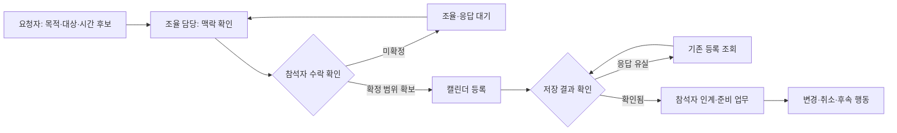

# 일정 MoW — 조율에서 실제 등록까지

제안 · 현업 관찰 전. 담당 역할과 승인 정책은 조직별로 합의합니다.

| 인계 | 전달물 | 확인할 것 | 되돌아갈 지점 |
|---|---|---|---|
| 요청자 → 조율 담당 | 목적·대상·후보 시각·원문 | 기준일과 시간대가 있는가 | 누락이면 요청자 확인 |
| 조율 담당 → 참석자 | 제안과 아직 미정인 부분 | 수락·조건부 수락·거절 | 조건이 바뀌면 조율 재개 |
| 참석자 → 등록 시스템 | 확정 범위·기준 버전 | 중복·충돌·등록 권한 | 충돌이면 조율 담당 확인 |
| 시스템 → 준비 담당 | 실제 저장 ID·시각·관련 업무 | 저장 성공과 전달 여부 | 응답 유실이면 조회 우선 |
| 변경 담당 → 참석자·업무 소유자 | 변경·취소 이유, 영향 범위 | 준비 업무를 유지할지 | 각 업무 소유자에게 판단 인계 |

## 가져가서 확인할 질문

- 캘린더에는 누가 쓸 권한이 있나요?
- 잠정 일정을 보관하는 위치와 실제 등록 상태가 구분되나요?
- 응답 대기는 누구에게 보이며 언제 다시 확인하나요?
- 취소된 미팅의 준비 자료는 계속 필요한가요?

## 출처와 가공

IScribe·writingAgent의 일정·행동·저장 책임 구분을 업무 인계 관점으로 정리했습니다. 실제 조직도나 운영 시스템 흐름을 공개한 것이 아닙니다. 고객사 A·담당자 A를 사용하는 합성 적용 사례이며 효과 측정은 수행하지 않았습니다. [SOP](schedules-sop.md)·[PRD](schedules-prd.md)를 함께 보세요.
