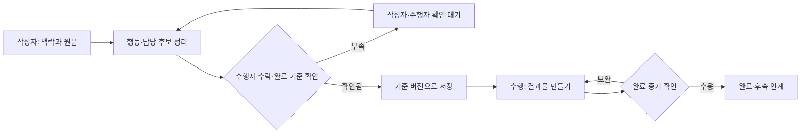

# 할 일 MoW — 누가 무엇을 기다리는가

제안 · 현업 관찰 전. 업무 지도는 시스템 호출 목록과 다릅니다.

| 인계 | 전달물 | 받는 사람의 판단 | 실패·대기·재개 |
|---|---|---|---|
| 작성자 → 업무 수행자 | 요청 내용, 근거, 대상, 기한 후보 | 내가 수행할 일인가, 수락했는가 | 역할 불명확이면 요청자에게 확인 |
| 수행자 → 시스템 | 확정한 범위, 업무 ID, 기준 버전 | 중복·버전 충돌 없는가 | 저장 응답 유실이면 동일 요청 조회 |
| 수행자 → 검토자 | 결과물, 완료 기준, 남은 제한 | 목적을 충족하는가 | 부족한 결과물을 명시하고 재작업 |
| 검토자 → 후속 담당 | 승인 범위, 결과 위치, 후속 조건 | 다음 업무를 시작할 수 있는가 | 의존 업무 미완료이면 대기 사유 기록 |

## 관찰할 지점

업무 시간과 대기 시간을 구분합니다. 같은 사람이 작성·수행·검토를 맡으면 별도 승인을 기계적으로 추가하지 않습니다. 반려 원인이 맥락 누락이면 문구만 고치지 말고 처음 인계로 돌아갑니다. 완료 추정과 실제 완료를 섞지 않습니다.

## 적용 예시와 출처

고객사 A에 보낼 자료를 담당자 A가 준비하고 담당자 B가 검토하는 합성 사례에 적용할 수 있습니다. IScribe·writingAgent의 행동·수정 경계를 업무 인계로 재해석한 지도이며, 실제 조직의 책임 배정이나 운영 성과를 재현한 기록이 아닙니다. [SOP](tasks-sop.md)·[PRD](tasks-prd.md)와 함께 적용 범위를 확인하세요.
