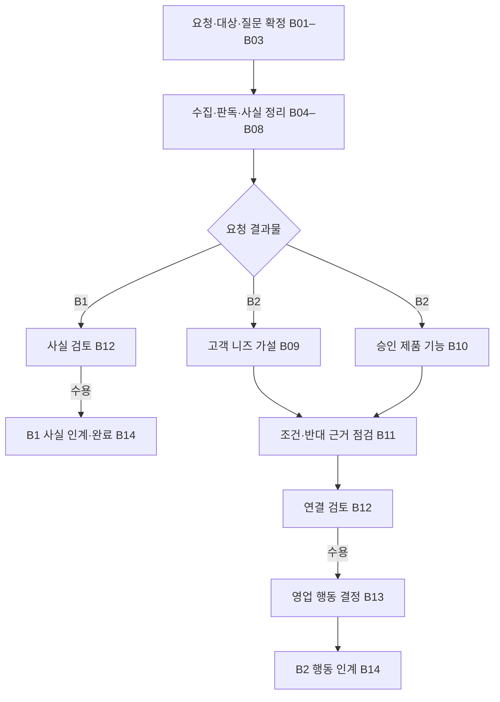
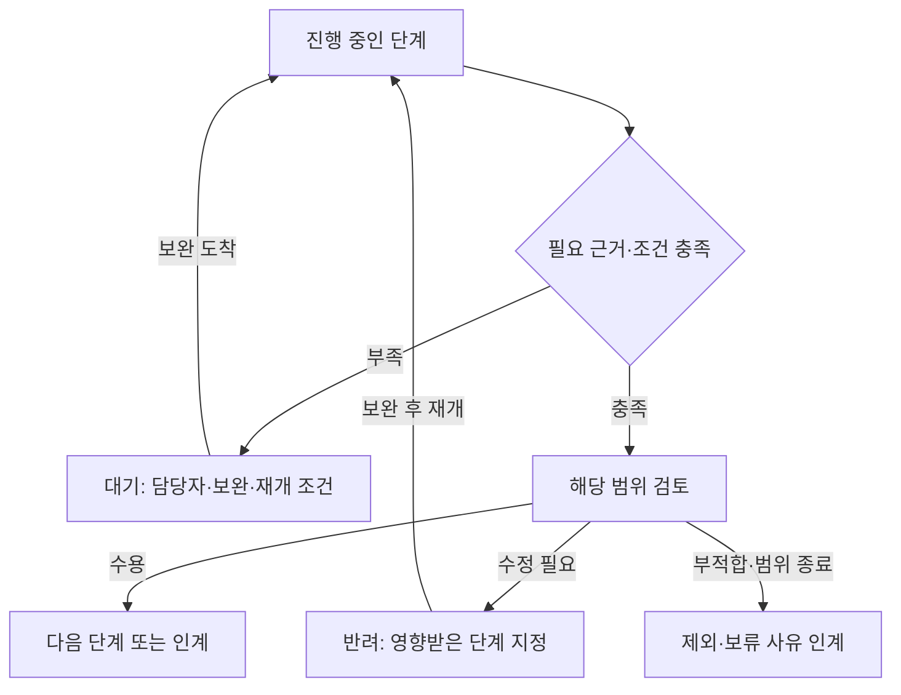

# 기업·제품 조사와 영업 연결 업무 지도

**문서 상태: Map of Work-B v0.1 제안 / 현업 관찰 전**

이 지도는 [SOP](sop.md)의 업무 의존성과 인계·대기·반려·재개를 보여줍니다. 현재 코드의 호출 순서나 운영 배포 구성을 그대로 나타내는 그림은 아닙니다. 실제 현업 관찰 후 현재 업무와 개선 업무를 각각 확정합니다.

## 1. B1 종료와 B2 연결 분기

B1은 검토한 사실을 인계하면 끝날 수 있습니다. B2는 고객 측 근거와 제품 측 근거가 모인 뒤 조건을 대조합니다. 제품 카탈로그가 이미 있다면 B10은 자료 수집과 함께 준비할 수 있습니다. 그림의 합류는 필요한 입력의 의존성을 뜻하며 모든 단계를 직렬 모델 호출로 구현하라는 뜻은 아닙니다.

## 2. 검토·대기·반려·재개

대기는 외부 답변이나 자료를 기다리는 상태이고, 반려는 현재 결과의 수정 대상과 이유를 지정한 상태입니다. 반려할 때 보고서 전체를 무조건 다시 생성하지 않습니다. 보완 뒤에는 영향을 받는 주장·계산·연결부터 재개합니다.

검토는 단계마다 별도 결재를 추가하는 절차가 아닙니다. 책임자는 정하되 연속된 의미 분석은 B12에서 통합 검토할 수 있습니다. 추가 확인은 식별 충돌, 자료 부족, 기능·환경 불일치와 중요한 약속 변경 등 합의한 예외에 적용합니다.

## 3. 인계별 필수 전달물

| 인계 | 보내는 담당 | 받는 담당 | 반드시 넘길 내용 | 대기·반려·재개 기준 |
|---|---|---|---|---|
| 요청 → 조사 | 현업 요청자 | 조사 담당자 | 목적, 법인 후보, B1/B2, 기간, 질문·완료 조건 | 대상·목적이 모호하면 요청자가 보완합니다. |
| 수집 → 사실 정리 | 수집 수행자·도구 | 조사 담당자 | 원문·출처 ID, 발행·수집·사건일, 문서 버전·판독 상태 | 동명 기업·부분 OCR·원문 부재는 관련 자료부터 보완합니다. |
| 사실 → 니즈 가설 | 조사 담당자 | 영업 담당자 | 확인된 사실, 자료 한계, 가설과 구분할 전제 | 실제 고객 문제·예산·도입 의사는 확인 질문으로 남깁니다. |
| 제품 자료 → 적합성 | 제품 담당자 | 조사·영업 담당자 | 승인 기능, 버전, 제약, 연동·환경, 표준/추가 개발 범위 | 자료가 없거나 조건이 맞지 않으면 대기·보류·제외합니다. |
| 연결 → 검토 | 조사·영업 담당자 | 제품·영업 검토자 | 고객 근거와 가설, 기능 근거, 조건·반대 근거 점검, 확인 질문 | 키워드 유사성만 있거나 필수 근거가 비면 미확인으로 돌립니다. |
| 검토 → 영업 행동 | 검토 담당자 | 영업 책임자 | 수용·보류·부적합 이유와 외부에 약속할 범위 | 고객 답변·승인된 대안을 확인한 뒤 다음 행동을 결정합니다. |
| 결과 → 후속 업무 | 업무 소유자 | 후속 담당자 | 검토본·근거·버전, 질문·담당자·기한/조건, 완료 상태 | 저장 실패는 기존 실행과 중복을 확인합니다. 변경된 근거는 관련 항목만 재검토합니다. |

## 4. 사람과 수행 수단의 역할

| 역할·수단 | 담당하는 일 | 최종 판단이 필요한 지점 |
|---|---|---|
| 현업 요청자 | 목적·대상·결과물·우선순위를 정합니다. | 범위 변경과 완료 조건을 결정합니다. |
| 조사 담당자 | 기업 동일성, 원문 범위, 사실·기간·수치의 적절성을 검토합니다. | 사실 채택·제외와 자료 한계를 판단합니다. |
| 제품 담당자 | 현재 기능·제약·버전·구축·지원 범위를 확인합니다. | 고객에게 제공·약속할 수 있는 기능을 판단합니다. |
| 영업 담당자 | 고객 맥락, 니즈 확인 질문과 다음 행동을 정합니다. | 가설 채택·보류·제외, 고객 확인과 영업 행동을 결정합니다. |
| 코드·API·RPA | 수집·형식·ID·정렬·중복·계산·캐시·상태 기록 등 정의된 규칙을 수행합니다. | 규칙과 오류 조건은 해당 업무·운영 담당자가 정합니다. |
| 파서·OCR·LLM | 추출, 구조화, 의미 설명, 비교·가설·질문 초안을 보조합니다. | 추출·의미 오류와 중요한 조건은 해당 담당자가 검토합니다. |
| 앱·IT 담당자 | 연동·저장·복구와 실행 상태를 관리합니다. | 중복 여부, 장애 범위와 재개 방법을 판단합니다. |

## 5. 상태와 완료를 읽는 기준

| 상태 | 의미 |
|---|---|
| 자료 준비 | 필요한 입력·출처·판독 범위를 확보하는 중입니다. |
| 사실 검토 | 주체·기간·숫자·서술을 원문과 대조하고 있습니다. |
| 고객 확인 대기 | 니즈나 적용 조건에 대한 고객 답변이 필요합니다. |
| 제품 확인 대기 | 기능·버전·제약에 대한 제품 담당자의 보완이 필요합니다. |
| 연결 검토 | 고객 가설과 제품 기능의 조건·반대 근거를 대조하고 있습니다. |
| 보류·부적합 | 부족한 조건 또는 맞지 않는 이유를 기록한 결과입니다. |
| 인계 완료 | 요청한 결과와 근거, 후속 담당자·행동을 전달했습니다. |

발행 가능, 현업 수용, 고객 니즈 확인, 영업기회 확정은 이 진행 상태와 별도로 기록합니다. 기술적으로 발행된 문서가 고객의 구매 의사를 확인한 결과는 아닙니다. B2 인계가 끝나더라도 실제 고객 접촉이나 계약이 완료됐다는 뜻은 아닙니다.

## 6. 현업 관찰에서 채울 항목

각 단계에 다음 항목을 실제 관찰값으로 추가합니다.

- 시작 계기, 입력·원문 위치, 수행자, 결과 책임자와 사용하는 시스템
- 적용 규칙, 실제 판단 이유, 건너뛴 단계와 예외 처리
- 산출물, 다음 담당자, 완료를 확인한 근거
- 작업 시간, 대기 시간, 수정 시간과 재작업 원인
- 반려 대상, 보완 담당자, 재개 조건과 사용한 버전

현재 값은 측정하지 않았습니다. 관찰 전 시간을 임의로 채우거나, 이 지도를 자동화 성능·운영 완료의 증거로 사용하지 않습니다.
