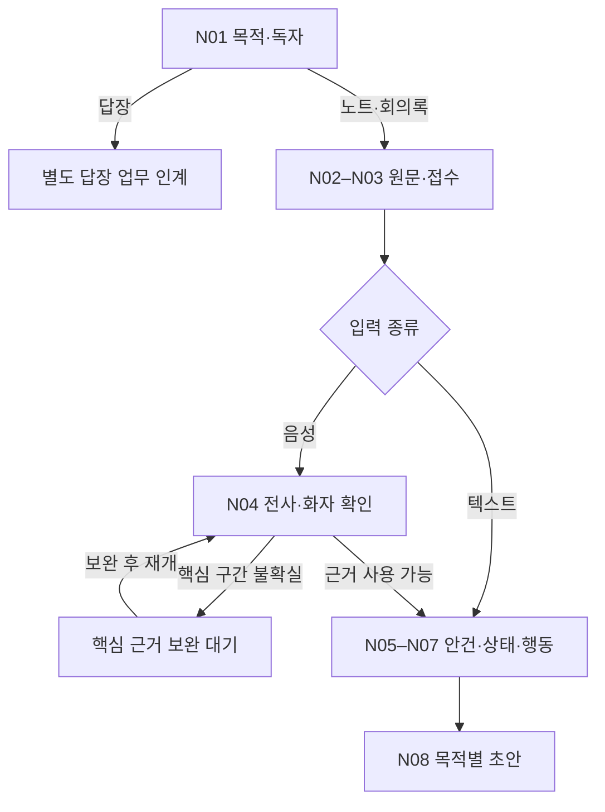
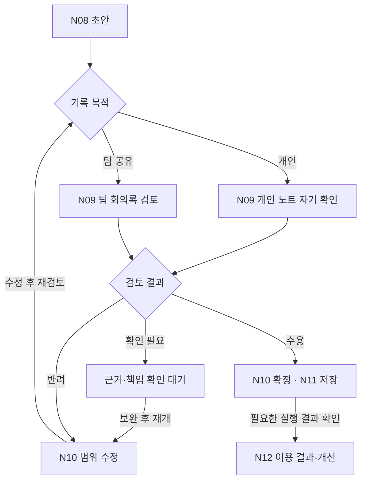

# 노트·회의록 Map of Work v0.1

> **제안 · 현업 미검증**  
> 실제 현업의 인계·대기·반려·재개를 관찰하기 위한 후보 지도입니다. 현재 코드의 호출 순서를 그대로 현업 절차로 확정한 것이 아닙니다. 기준일과 확인 범위는 [README](README.md)를 참조해 주세요.

## 지도를 읽는 기준

N01–N12는 [SOP](sop.md)의 업무 단계입니다. 연결된 [PRD](prd.md)는 각 단계에서 필요한 시스템 동작과 수용 조건을 설명합니다. 지도에서는 입력에서 초안까지의 흐름과 초안 이후 검토·완료 흐름을 나누어 봅니다.

한 단계는 한 번의 LLM 호출이 아니며, 화살표마다 사람 승인을 받는 것도 아닙니다. 실제 현업이 연속 수행하는 단계는 함께 처리할 수 있습니다. 개인 노트의 자기 확인과 팀 회의록의 검토는 목적과 책임을 구분한 것이며 별도 검토자를 항상 추가한다는 뜻은 아닙니다.

## 1. 원문에서 목적별 초안까지

텍스트 경로는 음성 전사를 건너뛰지만 핵심 이름·수치·날짜와 첨부 추출 내용을 확인합니다. 중간 청크의 전사는 임시본으로 유지하고, 최종 입력과 분석 성공이 확인된 결과만 최종 분석 초안으로 사용합니다. 실제 API의 상태 의미, 화면의 표시와 현업 인계는 기여별로 검증해야 합니다.

답장 분기는 기록 업무의 목적 선택을 보여 줍니다. 답장 초안 생성과 발송은 별도이며, 일반 노트 분석의 모든 산출물이 함께 생긴다고 가정하지 않습니다.

## 2. 초안에서 검토·수정·완료까지

반려의 원인이 전사·자료·안건 구분·상태 해석에 있으면 N10의 문장 수정만 반복하지 않고 해당 원인 단계로 돌아갑니다. N11의 저장·공유·등록 실패는 아래 복구 표에 따라 기존 결과를 확인한 뒤 재개합니다. 미결 사항을 정확히 기록하는 것으로 목적을 충족한 회의록은, 모든 안건이 확정될 때까지 무조건 기다리지 않습니다.

## 단계·주체·전달물

아래 주체 배정은 제안입니다. 도구는 수행 수단이며, 해당 업무의 사람 책임을 대신하지 않습니다. 실제 담당 이름과 조직은 현업 관찰 후 배정합니다.

| 단계 | 주된 수행·책임 제안 | 다음 단계에 넘길 내용 | 주요 PRD |
|---|---|---|---|
| N01 | 작성자, 결과를 사용하는 업무책임자 | 목적·독자·출력 유형·완료 조건 | PRD-N-01, PRD-N-11 |
| N02 | 작성자, 접수 코드·API | 원문 위치·첨부·기준시각·참여자 역할·누락 정보 | PRD-N-02, PRD-N-04 |
| N03 | 코드·API, 앱·IT 담당 | 접수·실행 ID, 사용 가능한 원문, 진행·실패 상태 | PRD-N-07, PRD-N-08 |
| N04 | ASR·화자분리 모델, 작성자·참석자 | 사용할 전사, 인물·용어 확인, 불확실 구간 | PRD-N-02, PRD-N-04 |
| N05 | LLM, 작성자 | 안건별 근거 묶음과 분리·통합 이유 | PRD-N-02, PRD-N-06 |
| N06 | LLM, 진행자·업무책임자 | 결론·요청·합의·미결의 상태, 판단 근거 | PRD-N-03, PRD-N-04 |
| N07 | LLM·형식 검사 코드, 업무 소유자 | 행동·역할·기한·산출물·수락·확정 상태 | PRD-N-04, PRD-N-05, PRD-N-10 |
| N08 | LLM·템플릿, 작성자 | 목적별 초안·근거·필수 항목 검토 목록 | PRD-N-01, PRD-N-06 |
| N09 | 형식 검사 코드, 합의한 현업 검토자 | 수용·수정·확인 필요, 이유·대상·담당자 | PRD-N-02, PRD-N-03, PRD-N-06, PRD-N-11 |
| N10 | LLM·보호 코드, 업무 소유자, 앱·IT | 변경 범위·유지 항목·충돌·확정 범위·기준 버전 | PRD-N-03, PRD-N-09, PRD-N-11 |
| N11 | 앱·API, 필요한 경우 RPA, 업무 소유자 | 저장 버전, 선택한 후속 조치별 실제 결과 | PRD-N-08, PRD-N-10, PRD-N-11 |
| N12 | 현업, AX 담당, 업무책임자 | 수정 이유·업무 영향·시간·채택 판단·규칙 버전 | PRD-N-12 |

정형 코드·API와 RPA는 구분합니다. 화면에서만 가능한 반복 작업이 확인될 때 RPA 필요성을 검토합니다. 특정 도구의 지원 기능을 전제하지 않습니다.

## 인계 지점의 최소 전달물

| 인계 | 전달할 내용 | 받는 쪽의 확인 |
|---|---|---|
| 입력 확보 → 의미 해석 | 원문 위치·기준시각·참여자 후보·미확인 구간 | 현재 사건의 범위와 사용할 근거가 충분한지 봅니다. |
| 해석 → 초안 작성 | 결정·요청·미결과 각각의 근거, 역할·기한·수락 상태 | 제안·요청이 합의로 바뀌지 않았는지 봅니다. |
| 초안 → 현업 검토 | 출력 유형·필수 사실 목록·초안·원문 연결 | 누락·왜곡·다음 행동·사용 목적을 봅니다. |
| 검토 → 수정·확정 | 판정·사유·수정 대상·변경 권한·보호 항목 | 문장 정정과 실제 업무 객체 변경을 구분합니다. |
| 확정 → 저장·후속 실행 | 확정 범위·대상 ID·기준 버전·선택한 조치 | 실행 권한·중복 여부·실제 결과를 확인합니다. |
| 이용 → 절차 개선 | 수정 전후·이유·원문 근거·시간·업무 영향 | 표현 선호와 반복되는 업무 규칙 문제를 구분합니다. |

## 검토·대기·반려·재개 규칙

| 발생 지점·상황 | 상태 | 넘길 대상 | 재개 조건 | 돌아갈 단계 |
|---|---|---|---|---|
| 첨부·기준일·참여자 맥락 누락 | 근거 보완 대기 | 작성자·자료 제공자 | 판단에 필요한 자료가 확보되거나 미확인 상태로 진행할 범위를 합의합니다. | N02 및 영향받은 단계 |
| 이름·수치·결정 구간의 전사 불명확 | 확인 대기 | 작성자·참석자 | 원음·발화자 확인 또는 불확실성 표시로 사용할 범위를 정합니다. | N04, 필요 시 N05–N07 |
| 요청·합의·권한이 상충 | 결정 확인 대기 | 진행자·업무책임자 | 현재 상태·조건·근거와 확인 권한자가 정리됩니다. | N06, 영향받은 N07–N08 |
| 초안의 사실·핵심 항목 누락·왜곡 | 반려 | 해당 안건 작성·검토 담당 | 수정 이유와 원문 근거를 바탕으로 관련 내용을 고칩니다. | 원인에 따라 N02–N08, 이후 N09 |
| 확정된 업무·일정과 수정안 충돌 | 변경 확인 대기 | 해당 업무·일정 소유자 | 보호할 항목과 실제 변경 범위를 정합니다. | N10, 이후 N09 |
| 전사는 성공하고 의미 분석 일부 실패 | 부분 결과·복구 대기 | 앱·IT 담당 | 기존 작업과 사용 가능한 결과를 확인하고 API가 지원하는 재실행 범위를 정합니다. | N03 및 필요한 분석 범위 |
| 저장·등록·전송 응답 유실 또는 실패 | 실행 확인·복구 대기 | 앱·IT 담당 | 대상 시스템 결과·대상 ID·중복 여부를 확인합니다. | N11 |
| 평가자 간 수용 기준 불일치 | 기준 조정 대기 | 현업 검토자·업무책임자·AX 담당 | 필수 사실·허용 표현·미확인 처리 기준을 합의합니다. | N12, 관련 SOP·PRD |

재개는 업무상 돌아갈 지점을 뜻합니다. 모든 API가 그 단계만 따로 재실행할 수 있다는 뜻은 아닙니다. 성공한 결과를 보존한 뒤 실제 지원 계약에 맞춰 실행 범위를 결정합니다. 단계별 재실행이 필요하지만 미지원이면 PRD-N-08의 추가 구현 요구로 남깁니다.

## 실행 상태와 업무 상태의 연결

| 확인할 상태 | 의미 | 다음 판단 |
|---|---|---|
| 접수·처리 중 | 시스템이 입력을 받았거나 처리하고 있습니다. | 아직 어떤 최종 결과도 완료로 간주하지 않습니다. |
| 전사 임시본 | 현재까지의 음성 내용이 누적됐습니다. | 최종 의미 분석 전임을 표시합니다. |
| 최종 분석 성공 | 분석 계약의 결과가 반환됐습니다. | 필요한 내용 검토를 수행합니다. |
| 부분 실패 | 일부 결과만 사용할 수 있습니다. | 성공한 결과와 복구 대상을 나눕니다. |
| 검토 수용 | 합의한 기준에서 내용을 사용할 수 있습니다. | 이번에 확정·저장·실행할 범위를 정합니다. |
| 저장 완료 | 대상 기록의 해당 버전이 저장됐습니다. | 공유·등록이 업무 범위이면 해당 결과도 확인합니다. |
| 필요한 후속 실행 완료 | 선택한 공유·등록·발송 등의 결과가 확인됐습니다. | N01의 업무 완료 조건을 판정합니다. |

청크·분석 상태의 의미는 사용하는 도구의 계약으로 확인해야 합니다. 검토·완료의 현업 상태명과 흐름은 제안입니다. 개인 노트와 팀 회의록을 같은 승인·완료 상태로 일괄 관리하지 않습니다.

## 현업 관찰에서 지도에 추가할 정보

최근 실제 한 건을 처리하는 모습을 보며 단계별 수행자, 사용하는 화면·자료, 실제 입력·출력, 사람 작업 시간과 대기 시간을 기록합니다. 다음 질문에 답한 뒤 이 후보 지도를 현재 업무 지도와 개선 업무 지도로 구분해 갱신합니다.

- 무엇이 있어야 다음 사람이나 시스템이 일을 시작할 수 있습니까?
- 기다리는 이유가 자료 부족, 판단 권한, 시스템 처리, 조직 관행 중 무엇입니까?
- 반려를 받은 사람이 수정 범위와 재개 조건을 바로 이해할 수 있습니까?
- 형식 오류는 코드로 처리하고 중요한 의미 판단만 사람에게 모을 수 있습니까?
- 업무를 끝내는 데 필요하지 않은 검토·중복 입력·재실행이 있습니까?
- 같은 사람이 여러 단계를 수행할 때 실제로 인계가 발생하는 지점은 어디입니까?

공개 문서의 예시는 합성 사례이며 실제 고객 자료를 포함하지 않습니다. 기여별 구현 근거와 공개 범위는 [README의 근거 목록](README.md#근거)을 참조해 주세요.
